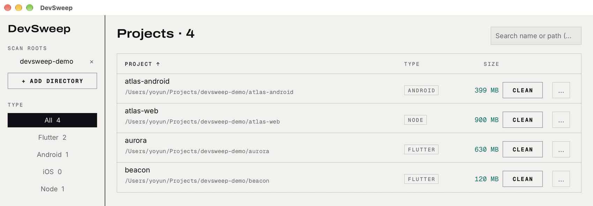

<p align="center">
  
</p>

<h1 align="center">DevSweep</h1>

<p align="center">
  <b>找出项目里悄悄吃掉几十 GB 的构建产物和依赖缓存，勾选不需要的部分，一次清掉。</b><br>
  macOS 与 Windows 上的本地应用：Flutter、Android、iOS、Java、Node、Python、Rust、.NET 项目，加上它们背后的全局缓存。
  没有云端，没有账号，数据不出本机。
</p>

<p align="center">
  
  
  
  
  <br>
  <a href="https://github.com/skana168/DevSweep/actions/workflows/ci.yml"></a>
  <a href="https://github.com/skana168/DevSweep/releases/latest"></a>
</p>

<p align="center">
  <a href="https://github.com/skana168/DevSweep/releases/latest"><b>下载 DevSweep</b></a> ·
  <a href="https://github.com/skana168/DevSweep/releases">全部版本</a> ·
  <a href="#从源码构建">从源码构建</a> ·
  <a href="docs/rules.md">规则参考</a> ·
  <a href="ROADMAP.md">开发计划（Roadmap）</a> ·
  <a href="README.md">English</a>
</p>

<p align="center">
  
</p>

## 它做什么

DevSweep 查找 Flutter、Android、iOS、Java、Node、Python、Rust 和 .NET 项目中的构建产物、依赖和缓存，以及共用的工具缓存。查看大小，选择要清理的内容，确认后执行。

## 功能

<table>
  <tr>
    <td width="33%" valign="top">
      <h3>🧹 每个项目一个面板</h3>
      列出项目里每一条可清理路径及其体积。危险项默认不勾，确认框会写明条目数、总大小，以及任何超过 5 GB 的单项。
    </td>
    <td width="33%" valign="top">
      <h3>📊 体积在后台算</h3>
      列表先出现，体积随后填入。可按类型过滤、按名称或路径搜索、按名称或体积排序。
    </td>
    <td width="33%" valign="top">
      <h3>🌍 项目之外的缓存</h3>
      一个页面汇总所有项目共用的包管理器与工具链缓存，各带真实体积；需要重新下载的条目会标注出来。
    </td>
  </tr>
</table>

### 全局缓存

| 依赖缓存 | 工具链缓存 |
|---|---|
| Gradle caches、Gradle distributions、Maven local repository、npm、pnpm、bun、Yarn、pub、CocoaPods、Go 模块缓存 | Playwright、Xcode DerivedData、Cargo registry、pip、Go 构建缓存 |

清理其中一条会同时为所有项目腾出空间，下一次构建会重新下载或重建它需要的东西。这份清单固定，
`rules.toml` 不能扩展也不能关闭它。

Go 构建缓存与模块缓存通过当前本机 Go 配置定位，包含环境变量及 `go env -w` 的覆盖。应用必须能找到 Go；
查询失败不会猜测默认路径。不存在或被安全检查拒绝的 Go 条目仍展示原因，不新增 Go 项目类型。

Go 缓存拒绝危险目录、链接，以及与已知项目或其他缓存重叠的路径；通过检查的家目录外自定义位置
可以使用。刷新会重新查询，执行前若位置变化则取消旧确认。两项均遵循所选废纸篓 / 直接删除方式。
构建缓存清理后，后续构建会变慢；模块缓存属于危险项，依赖需重新下载、离线构建可能失败，缓存内
手工修改会丢失。只读模块目录按受限范围处理权限，不提权；失败后可能保留权限变更。
请先停止 Go 构建、测试与依赖下载；应用不检测或锁定并发任务。失败会显示错误并重新测量剩余内容，
部分删除无法回滚。

## 安装

从 [Releases](https://github.com/skana168/DevSweep/releases/latest) 下载对应文件，或在
[全部版本](https://github.com/skana168/DevSweep/releases) 里挑选。`<版本>` 是版本号，例如 `0.3.0`。

| 平台 | 文件 | 用法 |
|---|---|---|
| macOS | `DevSweep_<版本>_macos.dmg` | 打开后把 DevSweep 拖进 Applications |
| Windows | `devsweep_<版本>_windows.zip` | 便携版：解压后直接运行 `devsweep.exe`，无需安装 |

> [!IMPORTANT]
> **发行包未签名、未公证**，所以系统会拦一次。这是预期行为，不是文件损坏。
>
> **macOS（Gatekeeper）**：双击提示「无法打开，因为 Apple 无法检查…」时，打开「系统设置 →
> 隐私与安全性」，在页面底部点「仍要打开」；或右键点 App 选「打开」再确认。也可以在终端去掉
> 隔离标记：
>
> ```sh
> xattr -dr com.apple.quarantine /Applications/DevSweep.app
> ```
>
> **Windows（SmartScreen）**：运行 exe 时若出现「Windows 已保护你的电脑」，点「更多信息」→
> 「仍要运行」。个别杀软会对未签名的新 exe 报未知发布者，你信任这个构建就放行。

## 使用

1. 侧栏点 `+ 添加目录`，加入放项目的父目录，如 `~/Projects`、`D:\code`
2. 点某一行的 `清理` 打开面板，逐项勾选要删的内容；危险项默认不勾
3. 点面板底部的 `清理 N 项 · 380 MB`，在确认框里核对后执行
4. 全局缓存在侧栏「全局缓存」，那里逐条清理
5. 每行的 `...` 菜单可直接打开项目文件夹或在终端打开

删除默认进入 **废纸篓**（Windows 为回收站），误删可恢复；设置里可改为直接删除。窗口重新获得
焦点且距上次扫描超过 30 秒会自动刷新：已有的体积会保留，面板里的勾选不跨次保留。

### Cargo 项目

目录中存在 `Cargo.toml` 文件即识别为 Rust 项目，不解析清单内容，包括自身没有包的 Workspace 根。
Workspace 根与成员目录分别展示，没有可清理项时也保留；不解析成员关系。项目发现限定在扫描根内，
最多向下五层，并跳过构建和依赖目录。每个项目只归一种类型，优先级为
Unity > Flutter > iOS > Android > Java > Node > Python > Rust > .NET；同目录有更高优先级类型标记时，保留已有类型，
独立 Rust 子目录仍可单独出现。

Rust 清理仅覆盖每个 Rust 项目根目录下真实的整个 `target/`，标为危险项且默认不勾选：其中可能有
最终二进制、文档和打包产物，也有构建缓存。Workspace 共享的根 `target/` 归根项目；成员只清自身
本地的 `target/`，不向上查找。普通文件和符号链接被排除，最终清理计划再次检查；规则覆盖不能
绕过这些检查或移除危险标记。

DevSweep 不运行 Cargo，也不解析自定义 target-dir/build-dir 设置。Rust 内置清理不会删除源码、
`Cargo.lock` 和 `.cargo/`；Cargo registry 全局缓存行为不变。请停止构建后再清理：不检测或锁定
正在进行的构建，最终检查与删除之间仍可能发生文件系统变化。

### .NET 项目

C#、F#、Visual Basic 共用 `.NET` 项目类型和筛选项。目录中存在扩展名为 `.csproj`、`.fsproj`、
`.vbproj` 的真实普通文件即触发识别，扩展名按 ASCII 大小写不敏感匹配。不解析内容，SDK 风格、
旧式项目、空文件与无效项目文件均可命中；同名目录和符号链接不触发识别。同目录多个项目文件只
显示一个项目；仅有 `.sln`、`.slnx`、`global.json` 或源码不触发识别。

.NET 优先级最低，保留已有混合项目归类；独立 .NET 子目录仍可单独出现。沿用五层扫描深度和平台
子目录归属规则。Unity 项目优先于生成的 .NET 工程，见下方只读支持说明。

清理仅覆盖每个 .NET 项目根目录直属、名称精确小写的真实 `bin/`、`obj/` 整个目录。两项分别统计和
勾选，均为危险项、默认不勾选；未勾选时也计入项目大小。删除所选目录也会删除其中手工放入的内容。
普通文件和符号链接在发现时被排除，最终清理计划再次检查；规则覆盖可禁用规则或显式改变默认勾选，
但不会移除危险标记或绕过验证。

自定义输出路径、集中式 `artifacts/`、`.vs/`、`TestResults/` 和 NuGet 全局缓存不在这些内置规则内。
DevSweep 不运行 dotnet 或 MSBuild，整目录清理不等价于 `dotnet clean`。请先停止构建：不检测或锁定
正在进行的构建，验证与删除之间仍可能发生文件系统变化。.NET 支持已在源码中实现，尚未发布。

### Unity 项目（只读）

同目录存在 `Assets/`、`ProjectSettings/` 目录及 `ProjectSettings/ProjectVersion.txt` 文件时，
识别为独立 Unity 类型，不依赖生成的 `.csproj`。Unity 优先于所有其他类型；内部 Packages、插件、
工具不单独列为项目，即使把内部目录另加为扫描根。类型筛选提供 Unity；项目行展示只读及版本说明，
截断的说明可悬停查看全文。

支持版本下限为 Unity 2022.3，按数值排序，包含 Unity 6 的 `6000.x` 格式。旧版、损坏或未知版本仍然
展示；这个下限仅表示支持范围，不代表所有早期版本都不安全。**本版所有 Unity 项目均只读，符合版本
范围也不能清理**；暂不提供 Unity 清理项或缓存体积。通用规则、自定义规则、规则覆盖均不能开放清理；
计划与执行入口都会拒绝 Unity 清理，包括手工构造的计划。

Library/Temp 清理及 Editor 忙碌/空闲/未知检查由后继票交付，本票未实现；尚无真实 Unity Editor 或
Windows Editor 验证证据。

## 自定义规则

项目规则是内置的；`rules.toml` 可以关闭某条、改默认勾选，或追加自己的目录：

| 平台 | 路径 |
|---|---|
| macOS | `~/Library/Application Support/DevSweep/rules.toml` |
| Windows | `%APPDATA%\DevSweep\rules.toml` |

文件不存在时，点界面里的「打开规则文件」会按模板生成带注释的默认文件。完整参考——每条内置规则
的 id、路径限制、示例——见 [`docs/rules.md`](docs/rules.md)。

## 从源码构建

需要 Rust stable；macOS 另需 Xcode Command Line Tools。

```sh
cargo run                    # 调试运行
cargo test                   # 只测 core，不开窗口
./scripts/bundle-macos.sh    # 产出 target/DevSweep_<版本>_macos.dmg
cargo build --release        # Windows 便携 exe：target\release\devsweep.exe
```

CI 在每次推送时于 macOS 与 Windows 上跑 `cargo test`。图标：`assets/icon.svg` 是源文件，由
`scripts/make-icons.sh` 渲染为 `assets/icon.png`（256 像素，在 README 中显示为 128×128）、
`assets/icon-macos.png`（1024 像素，底板 824 像素、四边留白 100 像素）、`assets/icon.icns`（macOS
应用包）与 `assets/icon.ico`（16–256 像素共九档，由 `build.rs` 嵌入 exe）。macOS 应用包保留系统
图标，直接启动开发二进制时使用 macOS PNG。脚本检查尺寸、透明度和留白。渲染结果已提交，
常规构建无需图标工具。

测试边界：自动化测试只覆盖 `src/` 里的 core（扫描、规则匹配、体积、计划、删除、配置）；UI 层
只测一件事——中文字形在每套字体里都画得出来（`src/theme.rs`）。

## 许可

[MIT](LICENSE)。

界面视觉取自 [Craft Launcher](https://github.com/storytold/craft-launcher) 的 ArtCraft 设计
（Apache-2.0）。字体为 Archivo、Inter、Geist Mono，中文字形是
[Maple Mono](https://github.com/subframe7536/maple-font) CN 的 GB2312 子集，均由
[SIL OFL 1.1](assets/fonts/) 授权。详见 [NOTICE](NOTICE) 与
[ADR 0002](docs/adr/0002-craft-theme-and-bundled-cjk-font.md)。
